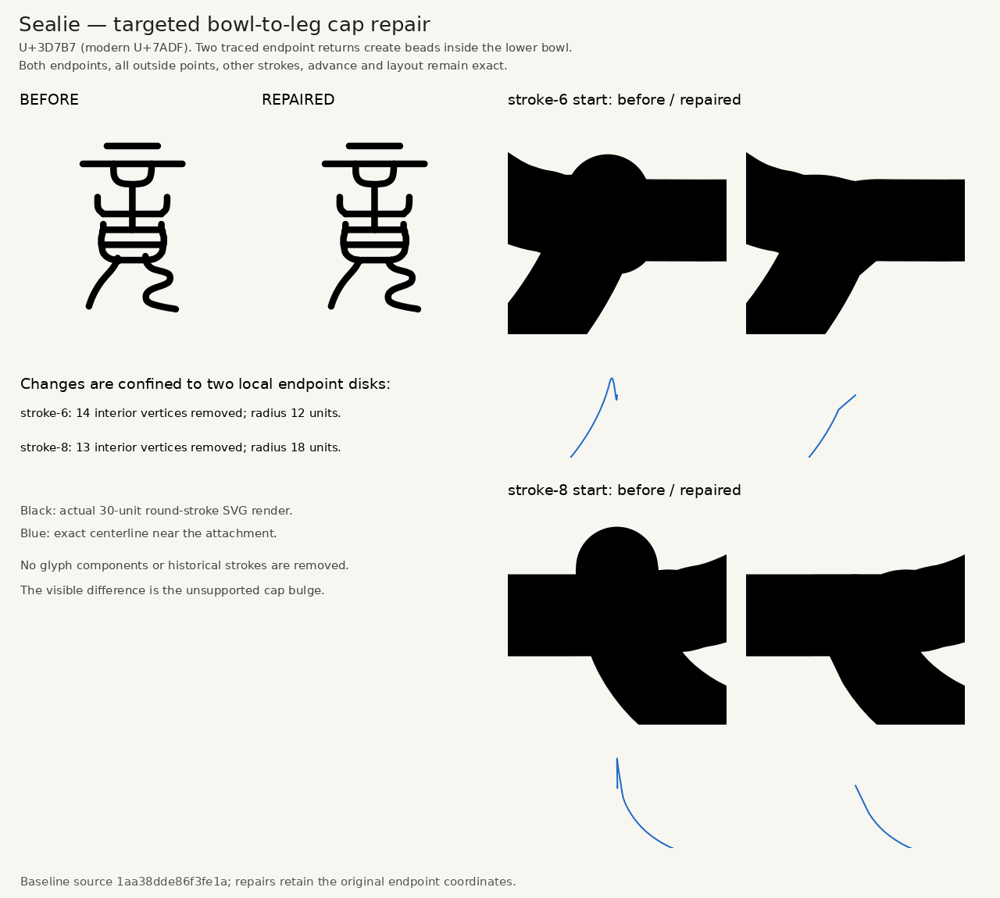

# Sealie

English · [简体中文](README.zh-CN.md)


Sealie is an AI-assisted Small Seal Gothic font developed by **ieb** with **OpenAI Codex (GPT-6)** and parallel subagents. It covers **all 11,328 Unicode 18 Small Seal codepoints, U+3D000–U+3FC3F**, in a rounded monoline style. The normalized font family is named **Sealie**.

The variable font spans **300–700**, with **400 as the default**. This normalized revision is a prerelease with geometric checks and representative visual review. The earlier Regular 400 reference reviews are preserved as source history; they do not establish full optical approval for the revised outlines. See the [coverage report](reports/coverage.json).

## Size and radical normalization

The original drawings shared a maximum height but varied considerably in width and visual balance. The first normalization adjusted compound widths and optical centering while preserving simple strokes, natural narrow forms and standalone radicals: **10,511 glyph sources changed; 817 remained identical.** The current follow-up also balances 26 broad compounds that missed the original height cutoff and cleans confirmed stroke-cap artifacts.

**2,846 glyphs now use 162 shared component templates.** The same reviewed radical, allograph and position uses exactly the same shape, size and placement. Ordinary left-side water, wood, hand and speech forms each share a canonical component; distinct positional or historical forms stay separate. Other strokes are reflowed within bounded scale limits, and uncertain or overly distorted matches keep their optical-only shape.

The shared SVGs live in [components/](components/). Editing one template and running `python tools/sync_components.py --apply` updates all its registered occurrences. See the [normalization details and comparisons](docs/NORMALIZATION.md).

All glyphs use the same pen width at each weight. Endpoint cleanup removes only terminal knots within a quarter of a font unit, preserving endpoints, stroke count and meaningful hooks. Larger cap repairs are reviewed individually. The [cap cleanup report](reports/cap-cleanup.json) and [additional size-fit report](reports/supplementary-size-fit.json) record the exact scope; two size proposals were held because they would join strokes at Regular weight.




## Models and creation process

Codex coordinated the work, wrote generation instructions and build tools, made vector repairs, and ran reviews. Parallel agents worked in **64-codepoint assignments**, with independent review before geometry was accepted. OpenAI image generation (`image_gen.imagegen`) produced the native character drawings. Python tracing and fontTools then turned the reviewed drawings into font geometry.

The process was:

1. **Read the references.** Character structures were compared with the THX, CCZ, QJZ and DYC specimens available in the official Unicode charts. When specimens differed, the drawing followed a coherent attested form.
2. **Create and review each drawing.** Generated drawings were checked for the correct branches, detached strokes, counters and proportions. Failed drawings and later vector corrections were recorded separately.
3. **Construct centerlines.** Automatic tracking followed the skeleton of the generated drawing and fitted editable centerlines. Reviewed vector overrides corrected structural or tracing defects. Reference-font outlines were not extracted to construct the font.
4. **Apply one shared style.** Drawings were initially proportionally fitted within a 1024-unit em, with a 1024-unit advance and a maximum centerline extent of 738 units. The current revision adds bounded optical sizing and shared radical slots. Regular uses a 30-unit pen with round caps and joins. The variable weights share the same centerlines and change the pen width.
5. **Review the actual font.** Independent agent reviews compared the compiled Regular glyphs with the references. Coverage, bounds, spacing and serialized glyph data were checked, and accepted geometry was bound to hashes. Unchanged work reused prior checks when its recorded geometry and font data matched.

These are AI-assisted designs with recorded review, rather than specialist paleographic certification. The source path order does not establish historical writing order. Building or using the published font requires no AI service or model key.

## SVG source and builds

**[svg/](svg/) is the maintained glyph source in this repository**, alongside the reusable [component templates](components/). It contains one editable SVG per codepoint and a [manifest](svg/manifest.json) binding the filenames, codepoints and hashes. The SVGs contain exact centerlines in the `seal-centerline-1` format. Private drawing drafts and reference images are not needed to build the static or variable fonts.

With Python 3.11 or newer, run from the repository root:

```sh
python -m pip install -r requirements.txt
python tools/sync_components.py --check
python tools/build_normalized_fonts.py --svg-dir svg --output build
```

This creates five named-weight TTFs, `Variable.ttf`, Regular and variable WOFFs, 64-glyph variable webfont subsets and a build manifest. Add `--woff2` for a Regular WOFF2. The [Build font from SVG workflow](https://github.com/iebb/sealie/actions/workflows/build-font.yml) runs the same builder and uploads the fonts. It can run manually or after source/tooling changes.

See the [build and editing guide](docs/BUILD-FROM-SVG.md) for the SVG constraints, manifest updates and validation commands.

## Downloads and previews

- [Normalized font prerelease and ZIP download](https://github.com/iebb/sealie/releases/tag/normalized-caps-011328)
- [Regular WOFF](fonts/Sealie-Regular.woff) · [webfont files](fonts/)
- [Variable webfont CSS](fonts/variable.css) · [177 webfont subsets, at most 64 glyphs each](fonts/variable/)
- [Weight preview](previews/weight-slider.html)
- [45 square PNG grid sheets covering the complete repertoire](png/)
- [Editable SVG sources](svg/)

Download all four ZIP parts linked from the release (`.001` through `.004`) into one folder. 7-Zip can open the first part when all are present. On macOS/Linux, join and extract them:

```sh
cat Sealie-Normalized-Caps-011328.zip.* > Sealie-Normalized-Caps-011328.zip
unzip Sealie-Normalized-Caps-011328.zip
```

The bundle contains the variable TTF, five named-weight TTFs, webfonts and licenses. The webfont CSS loads small subsets as needed. Small Seal uses its own Unicode codepoints; typing an ordinary CJK character does not automatically select its seal form. The [earlier checkpoint](https://github.com/iebb/sealie/releases/tag/checkpoint-011328) remains available for comparisons.


The grid sheets use 16×16 cells per sheet, with 128-pixel cells. Individual 16×16-pixel glyph PNGs are no longer tracked; edit the SVG sources instead.

## Contributions

**Contributions and commits are welcome**, including glyph corrections, spacing improvements, documentation and build-tool fixes. For a glyph correction, identify the codepoint, explain the structural issue and include the reference or comparison used to assess it.

For a shared radical, edit its SVG in `components/` and run `python tools/sync_components.py --apply`. For other strokes, edit `svg/Uxxxxx.svg`, preserving its codepoint, advance, group transform and round-stroke attributes. After an intentional edit, refresh the manifest, check shared components and build:

```sh
python tools/svg_font.py --svg-dir svg --refresh-manifest
python tools/sync_components.py --check
python tools/build_normalized_fonts.py --svg-dir svg --output build
```

Review the rendered glyph before submitting a focused commit or pull request. Refreshing a hash records new source bytes; it does not give the change visual approval. Keep glyph sources as SVGs and generated individual bitmaps out of commits.

## Artwork and license

The marketing artwork uses “道可道，非常道” from the first chapter of the *Dao De Jing*, with project glyphs from the earlier checkpoint at weights 300, 400, 500, 600 and 700 in shades of gray. Image generation added the paper and ink finish to a rendered font specimen. The [exact-font SVG reference](marketing/sealie-dao-reference.svg) and [artwork provenance](marketing/provenance.json) are included.

Fonts, SVG sources and font software are distributed under the **SIL Open Font License 1.1**. See [LICENSE-OFL.txt](LICENSE-OFL.txt) and [OFL-1.1.txt](OFL-1.1.txt).
