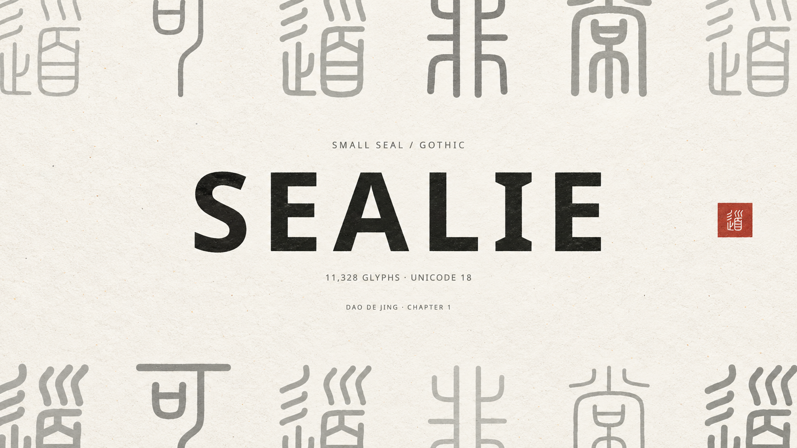
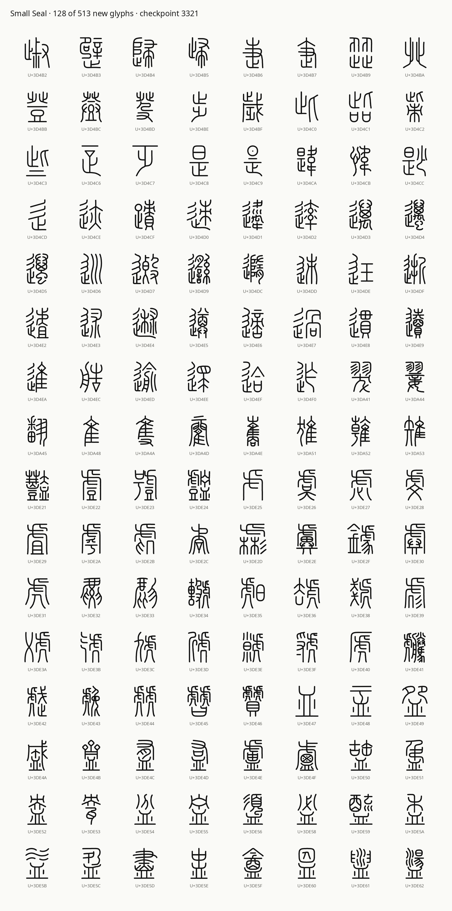

# Sealie



《道德經》「道可道，非常道」. [Exact-font SVG reference](marketing/sealie-dao-reference.svg).

Built outputs for the Panorama Gothic Small Seal font for Unicode 18.

Complete Unicode 18 Small Seal coverage: **all 11,328 codepoints, U+3D000–U+3FC3F, are available and reviewed at Regular 400**.

- [Font ZIP part 1 of 13](fonts/Sealie-SmallSeal-011328.zip.001)
- [Font ZIP part 2 of 13](fonts/Sealie-SmallSeal-011328.zip.002)
- [Font ZIP part 3 of 13](fonts/Sealie-SmallSeal-011328.zip.003)
- [Font ZIP part 4 of 13](fonts/Sealie-SmallSeal-011328.zip.004)
- [Font ZIP part 5 of 13](fonts/Sealie-SmallSeal-011328.zip.005)
- [Font ZIP part 6 of 13](fonts/Sealie-SmallSeal-011328.zip.006)
- [Font ZIP part 7 of 13](fonts/Sealie-SmallSeal-011328.zip.007)
- [Font ZIP part 8 of 13](fonts/Sealie-SmallSeal-011328.zip.008)
- [Font ZIP part 9 of 13](fonts/Sealie-SmallSeal-011328.zip.009)
- [Font ZIP part 10 of 13](fonts/Sealie-SmallSeal-011328.zip.010)
- [Font ZIP part 11 of 13](fonts/Sealie-SmallSeal-011328.zip.011)
- [Font ZIP part 12 of 13](fonts/Sealie-SmallSeal-011328.zip.012)
- [Font ZIP part 13 of 13](fonts/Sealie-SmallSeal-011328.zip.013)
- [Variable webfont CSS](fonts/variable.css) · [64-glyph webfonts](fonts/variable/)
- [Regular WOFF](fonts/PanoramaGothicSealIndividual-Regular.woff)
- [Weight preview](previews/weight-slider.html)
- [All codepoints in 16×16 PNG grids](png/)
- [Individual 16×16-pixel PNGs](png16/)
- [Editable per-glyph SVGs](svg/)
- [Build a font from SVG](docs/BUILD-FROM-SVG.md) · [GitHub workflow](https://github.com/iebb/sealie/actions/workflows/build-font.yml)
- [Coverage and validation](reports/coverage.json)

Download every ZIP part into one folder. 7-Zip can open the first part when all parts are present. On macOS/Linux, join and extract them:

```sh
cat Sealie-SmallSeal-011328.zip.* > Sealie-SmallSeal-011328.zip
unzip Sealie-SmallSeal-011328.zip
```

The ZIP includes the variable TTF, direct Regular, five named-weight TTFs, WOFF files and licenses. The Regular WOFF and variable webfont subsets stay in [fonts](fonts/) for local browser previews. The glyphs use a shared rounded monoline construction with proportional sizing and a 1024-unit advance. The original 128 outlines and metrics remain unchanged. All five named weights pass compiled size checks; their optical review continues.

A sample of the completed Small Seal repertoire:



Each of the 11,328 codepoints has a normalized, editable SVG and a transparent 16×16-pixel PNG. The 45 square PNG sheets cover the full Small Seal block in 16×16 grids of 128-pixel cells. Cells beyond U+3FC3F on the last sheet are outside the block.

To rebuild the Regular font from the SVGs, run from the repository root:

```sh
python -m pip install -r requirements.txt
python tools/svg_font.py --svg-dir svg --output build
```

This creates Regular TTF and WOFF2 files. The same build is available in GitHub Actions. The [build guide](docs/BUILD-FROM-SVG.md) explains editing and the SVG format. Production variable fonts remain available in the download bundle.

This repository publishes font files, editable SVG outputs, grid previews, licenses, reports, and the SVG build workflow. Private authoring drafts and reference images stay in the working repository. Paths inside diagnostic reports identify that build workspace.

Fonts are distributed under the [SIL Open Font License](OFL-1.1.txt).
