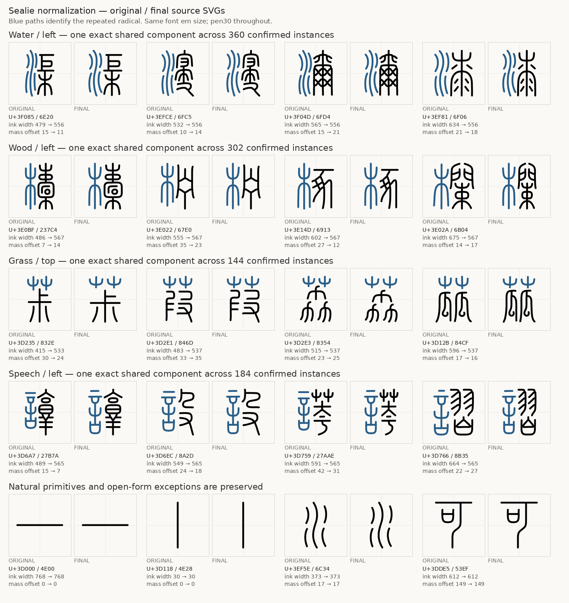
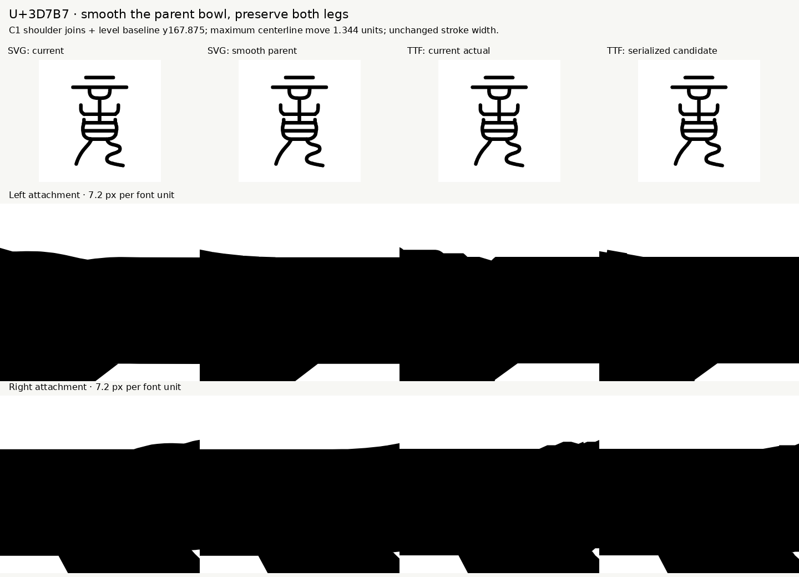
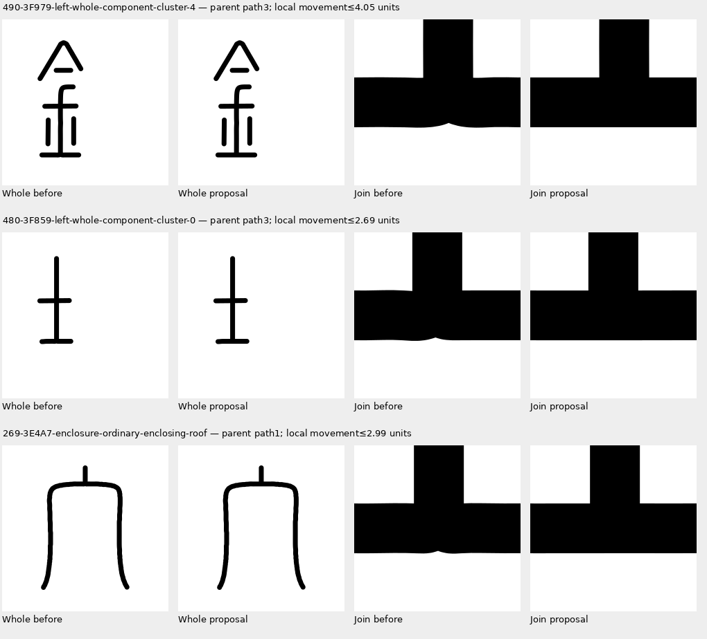

# Sealie

[English](README.md) · 简体中文


Sealie 是由 **ieb** 主导，使用 **OpenAI Codex（GPT-6）**及多个并行子代理协作制作的小篆黑体。字体以圆头等线风格，覆盖 **Unicode 18 小篆区块的全部 11,328 个码位：U+3D000–U+3FC3F**。规范化版本的字体家族名称为 **Sealie**。

可变字体提供 **300–700** 字重，默认字重为 **400**。当前规范化版本仍为预发布版，已经过几何检查和代表性样例的视觉审查。先前 Regular 400 的参考审查作为源文件历史保留，并不代表修改后的全部轮廓已完成视觉验收。详见[覆盖报告](reports/coverage.json)。

## 字面与部件规范化

原字形虽然具有统一的最大高度，但宽度与视觉重心仍存在明显差异。首轮规范化调整复合字的宽度及视觉居中，同时保留简单笔画、自然狭长字形和独立部首的原有比例：**10,511 个字形源文件发生变化，817 个保持原样。** 后续修正还调整了 26 个因高度略低于原阈值而遗漏的偏宽复合字，并清理已确认的笔端路径问题。本次版本进一步扩展共享偏旁，并修整笔画连接处可见的曲线起伏。

**3,473 个字形现在使用 173 个共享部件模板。** 本次新增 627 个登记字形：309 个采用已有模板，318 个采用 11 个新增模板。新增共享形式包括左侧人、石，右侧刀，两种笔画接触关系不同的虫，以及特定位置的日、口。登记为同一偏旁、形式及位置的部件，使用完全相同的形状、尺寸和放置位置；不同结构形式及位置仍分别处理。其余笔画在有限的缩放范围内重新排布。存在歧义或会造成笔画粘连的方案保留原有几何数据。精确共享仅适用于已登记的部件，其余字形仍保留独立 SVG。具体范围见[偏旁扩展报告](reports/radical-expansion.json)。

共享 SVG 位于 [components/](components/)。修改模板后，运行 `python tools/sync_components.py --apply` 即可同步更新其所有登记字形。详见[规范化说明与对比](docs/NORMALIZATION.md)。

同一字重的全部字形共用相同笔宽。U+3D7B7 下部弧线与下伸笔画连接处的残余凸起，来自连接处主笔画曲线的局部起伏。本次修整这些连接，并平滑三个共享模板中类似的主笔画曲线起伏；每个模板的修改同步到所有登记字形。修整保留端点、周围曲线及经过审查的钩形，具体范围见[连接处修整报告](reports/join-refinement.json)。先前的[笔端清理报告](reports/cap-cleanup.json)作为历史记录保留。[补充字面调整报告](reports/supplementary-size-fit.json)记录此前 26 个复合字的调整，以及两个因可能在 Regular 字重造成笔画粘连而保留原样的方案。







## 使用的模型与制作过程

Codex 负责协调任务、编写生成指令和构建工具、修正矢量字形，并组织审查。多个子代理按**每批 64 个码位**并行工作，字形几何数据通过独立审查后才被接受。OpenAI 图像生成工具（`image_gen.imagegen`）用于生成原始单字图；随后通过 Python 中心线追踪与 fontTools，将经过审查的字形转换成字体轮廓。

具体流程如下：

1. **查阅字形参考。** 对照 Unicode 官方码表中可用的 THX、CCZ、QJZ、DYC 字形资料，核对字形结构。不同资料存在异体差异时，选择有依据且结构一致的形式。
2. **生成并审查单字图。** 检查分支、分离笔画、字腔及比例。未通过的原始图与后续的矢量修正分别保留记录。
3. **构造笔画中心线。** 自动追踪生成图的骨架，拟合成可编辑的中心线，再通过经过审查的矢量修正处理结构或追踪问题。字体轮廓并非从参考字体中提取。
4. **统一设计参数。** 原始字形先按比例归一化到 1024 单位的 em 方框中，字宽固定为 1024 单位，中心线最大尺寸为 738 单位。当前版本再进行有限的字面调整，并为相同偏旁设置共享位置。Regular 的笔画宽度为 30 单位，使用圆头和圆角连接。各可变字重共用中心线，通过改变笔宽生成。
5. **检查实际编译结果。** 独立代理将编译后的 Regular 字形与参考资料进行比较，并检查覆盖范围、边界、字宽与序列化字形数据。通过审查的几何数据使用哈希绑定；几何与字体数据一致时，复用已有检查结果。

这是经过记录和审查的 AI 辅助字体设计，并不代表古文字学专家认证。源文件中路径的排列顺序也不代表历史笔顺。构建和使用已发布的字体无需调用 AI 服务，也不需要模型密钥。

## SVG 源文件与构建

**[svg/](svg/) 是本仓库维护的字形源文件目录**，并与可复用的[部件模板](components/)配合使用。每个码位对应一个可编辑的 SVG，[清单文件](svg/manifest.json)记录文件名、码位及哈希。SVG 使用 `seal-centerline-1` 格式，保存精确的笔画中心线。构建静态字体和可变字体均不需要私有工作区中的草稿或参考图片。

安装 Python 3.11 或更新版本后，在仓库根目录运行：

```sh
python -m pip install -r requirements.txt
python tools/sync_components.py --check
python tools/build_normalized_fonts.py --svg-dir svg --output build
```

命令生成五个命名字重的 TTF、`Variable.ttf`、Regular 和可变 WOFF、每份最多 64 字的可变网页字体子集，以及构建清单。添加 `--woff2` 可额外生成 Regular WOFF2。[Build font from SVG 工作流](https://github.com/iebb/sealie/actions/workflows/build-font.yml)使用同一构建器并上传字体，可手动运行，也可由源文件或工具代码变更触发。

SVG 格式限制、清单更新与验证命令见[构建和编辑指南](docs/BUILD-FROM-SVG.md)。

## 下载与预览

- [偏旁与连接处修整预发布版及 ZIP 下载](https://github.com/iebb/sealie/releases/tag/radical-joins-011328)
- [Regular WOFF](fonts/Sealie-Regular.woff) · [网页字体文件](fonts/)
- [可变网页字体 CSS](fonts/variable.css) · [177 个网页字体子集，每个最多 64 字](fonts/variable/)
- [字重预览](previews/weight-slider.html)
- [覆盖完整字集的 45 张方形 PNG 网格预览](png/)
- [可编辑的 SVG 源文件](svg/)

从发布页面下载 `.001` 至 `.004` 全部四个 ZIP 分卷，放入同一目录。分卷齐全后，可用 7-Zip 打开第一卷。macOS 或 Linux 可先合并再解压：

```sh
cat Sealie-Radical-Joins-011328.zip.* > Sealie-Radical-Joins-011328.zip
unzip Sealie-Radical-Joins-011328.zip
```

下载包包含可变 TTF、五个命名字重的 TTF、网页字体文件及许可证。网页字体 CSS 会按需加载较小的字体子集。小篆使用独立的 Unicode 码位，输入普通汉字不会自动转换成对应的小篆字形。[先前的检查点版本](https://github.com/iebb/sealie/releases/tag/checkpoint-011328)仍可下载用于对比。


网格预览每张包含 16×16 个单元格，每格为 128 像素。仓库不再跟踪逐字的 16×16 像素 PNG；字形修改请直接编辑 SVG 源文件。

## 参与贡献

**欢迎贡献和提交代码**，包括字形修正、字距改进、文档完善及构建工具修复。提交字形修正时，请注明码位、说明结构问题，并附上用于判断的参考资料或对比图。

修改共享偏旁时，请编辑 `components/` 中相应的 SVG，再运行 `python tools/sync_components.py --apply`。修改其他笔画时，编辑 `svg/Uxxxxx.svg`，保留码位、字宽、分组变换及圆头笔画属性。有意修改源文件后，刷新清单、检查共享部件并构建：

```sh
python tools/svg_font.py --svg-dir svg --refresh-manifest
python tools/sync_components.py --check
python tools/build_normalized_fonts.py --svg-dir svg --output build
```

检查渲染后的字形，再提交范围明确的 commit 或 pull request。刷新哈希仅记录新的源文件内容，并不表示该修改已经通过视觉审查。字形源文件应保持为 SVG，请勿提交生成的逐字位图。

## 宣传图与许可证

宣传图使用《道德经》第一章中的“道可道，非常道”，以本项目先前检查点版本的字形，在 300、400、500、600、700 字重和不同灰度下排版。图像生成工具在字体排版图的基础上添加了纸张与油墨质感。仓库同时提供[使用精确字形的 SVG 参考图](marketing/sealie-dao-reference.svg)及[制作来源记录](marketing/provenance.json)。

字体、SVG 源文件和字体软件采用 **SIL Open Font License 1.1**。详见 [LICENSE-OFL.txt](LICENSE-OFL.txt) 和 [OFL-1.1.txt](OFL-1.1.txt)。
