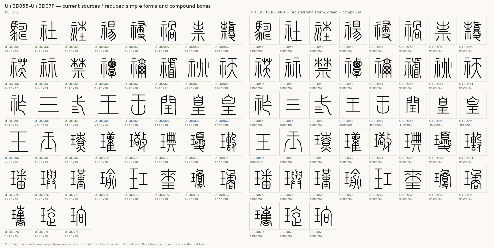
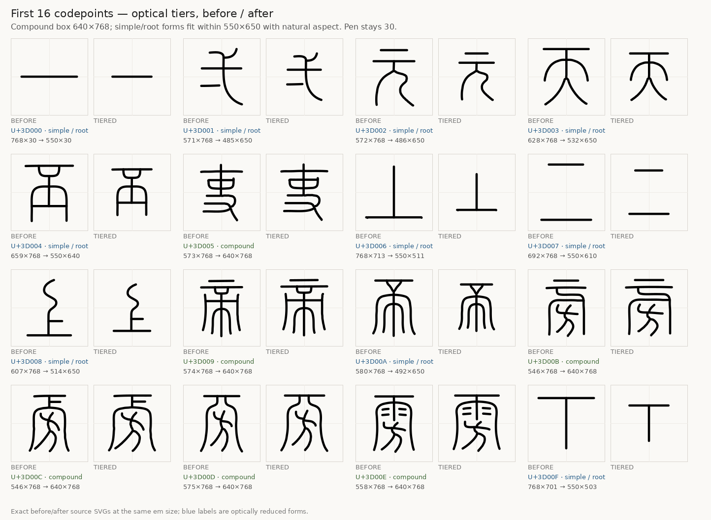
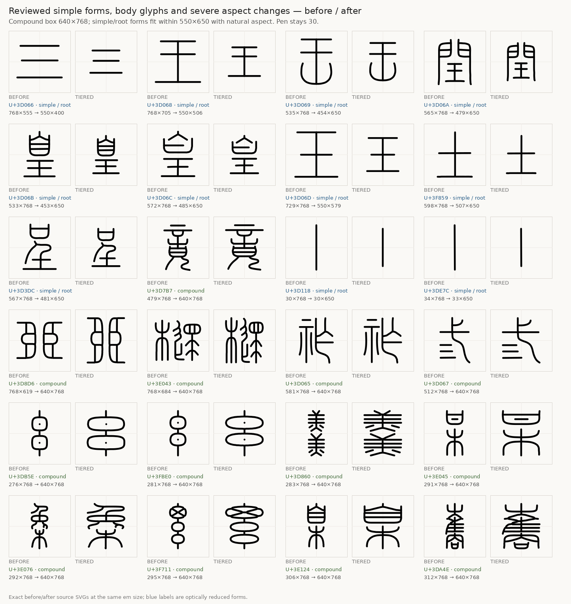
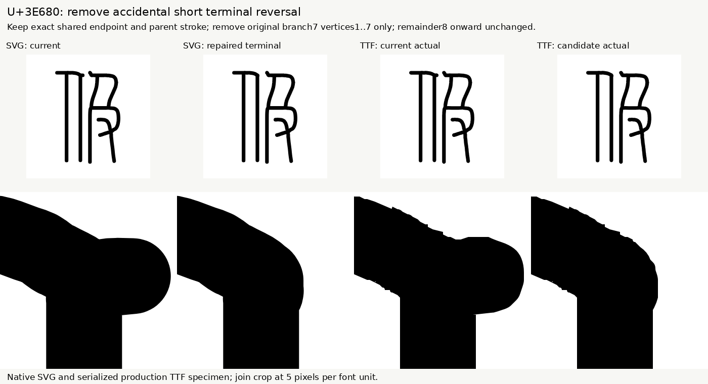

# Optical sizing and shared radicals

The current **v1.0.0** design covers all 11,328 Small Seal codepoints. It uses two optical size classes so simple characters do not appear as large as dense compounds. The em and advance remain 1024 units; Regular retains a 30-unit round pen.

## Two size classes

Sizes below are source ink bounds, including the 30-unit Regular pen, in the 1024-unit font frame.

| Class | Glyphs | Ink-size target | Treatment |
| --- | ---: | --- | --- |
| Compounds | 10,387 | 640×768 units | Fit width and height while retaining the shared pen |
| Simple whole forms and standalone roots | 941 | At most 550×650 units | Preserve natural proportions, shrink only, never upscale |

**10,384 compounds reach exactly 640×768.** Three—U+3DAFB, U+3DAFF and U+3E96C—stop at contact-safe fits. Eighteen simple forms also stop before the full reduction because further shrinking would introduce a Regular-weight contact or lose the existing half-unit safety margin. Those exceptions can exceed the nominal 550×650 target; the target is not an unconditional maximum for every glyph.

Simple forms are not stretched to fill a box. For example, U+3D000 is a **550×30-unit horizontal stroke**. The 王/玉 group and related simple forms keep their proportions at a smaller scale, while neighboring compounds retain the larger compound target. Stroke width remains 30 units throughout. All counts, fitted sizes and exceptions are in [optical-sizing.json](../reports/optical-sizing.json).







## Exact shared radicals

The official `kSEAL_Rad` classification in [SealSources.txt](https://www.unicode.org/Public/18.0.0/ucd/SealSources.txt) provides semantic families, not automatic stroke assignments. Whole components are reviewed within the same position and structural allograph before sharing is applied. Partial radicals, extra body strokes, different joins and ambiguous matches are excluded.

The current atlas contains **180 templates used by 3,763 glyphs**. This revision adds **290 occurrences**: 219 extensions of existing templates, eight 雨 assignments, and 63 assignments across seven new 子、鳥、巾 templates. See [radical-expansion-v4.json](../reports/radical-expansion-v4.json).

Every registered copy retains **exactly the same component geometry, dimensions and placement**. Optical sizing transforms each canonical template once, then fits its glyphs' remaining strokes around the shared slot. It does not independently stretch each registered copy. Component-to-remainder centerline clearance remains at least 35 units.

The earlier role-insertion step limited composed remainder scales to 0.80–1.25 relative to its input; the subsequent optical sizing is a separate, reported transform. Whole-path Regular30 checks preserve existing contacts and the half-unit margin. Noncontractive affine cases use the distance-monotonicity proof rather than claiming a pairwise distance check that was not executed. Same-path self-overlap and other weights are outside that contact guard.

To propagate an intentional template edit:

```sh
python tools/sync_components.py --apply
python tools/sync_components.py --check
```

The check verifies exact registered copies, closures, assignment integrity and current hashes. Exact sharing applies to these registered occurrences; other forms remain individually drawn.

## Cap and join corrections

Three reviewed shared parent-curve corrections propagate to **46 glyphs**. A separate terminal repair in **U+3E680** removes seven local vertices while preserving its endpoint and the later stroke course. Unrelated paths, closure flags and geometry outside the reviewed windows remain fixed. These are bounded source repairs, followed by optical sizing—not a general smoothing of every curve.



The [cap-refinement report](../reports/cap-refinement.json) records the repair scope and source identities. The endpoint cleanup check remains available through `python tools/cleanup_caps.py --check`.

## Builds and evidence

The [build guide](BUILD-FROM-SVG.md) explains static and 300–700 variable builds from the maintained SVG sources. [Current compiled validation](../reports/normalized-font-validation.json) is separate from historical reference review. The prior 11-test builder fixture result is reused because the builder and fixtures are unchanged; this revision does not claim eleven new fixture runs. Further optical review, particularly of dense forms at heavier weights, remains distinct from geometric validation.

The original [normalization metrics](../reports/normalization.json), [component review](../reports/normalization-review.json), earlier size-fit reports and older comparison images retain their original source scope. They do not measure the current optical size classes. Earlier sources remain in Git history: [initial complete checkpoint](https://github.com/iebb/sealie/tree/checkpoint-011328) and [radical/join revision](https://github.com/iebb/sealie/tree/radical-joins-011328).

[Live variable specimen](https://iebb.github.io/sealie/) · [Stable v1.0.0](https://github.com/iebb/sealie/releases/tag/v1.0.0) · [Latest font assets](https://github.com/iebb/sealie/releases/latest)
