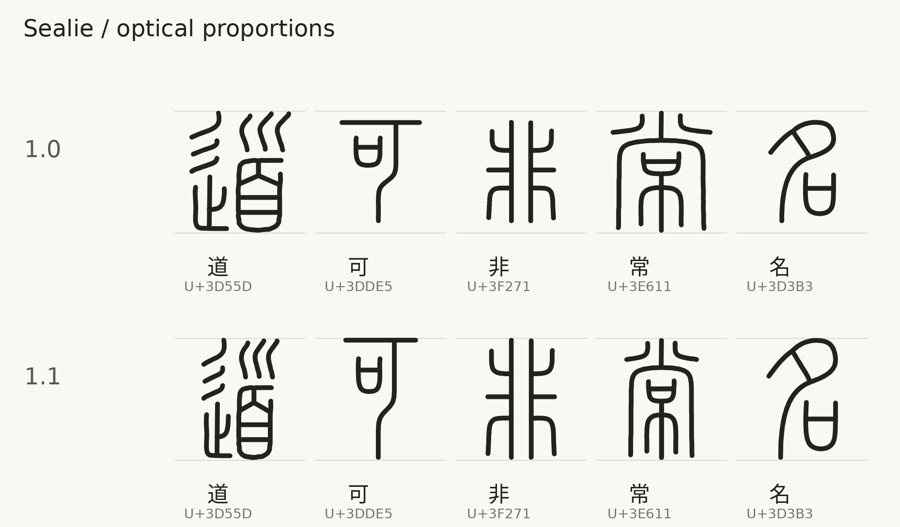
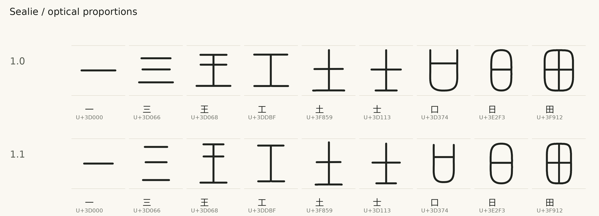

# Optical sizing and shared radicals

Sealie uses a common vertical rhythm with naturally different character widths. The **v1.1.0** sources cover all 11,328 Small Seal codepoints in a 1024-unit em, with a fixed 1024-unit advance. Regular uses a 30-unit round pen.

## Optical body heights

Ordinary upright forms use a **768-unit ink height** and common vertical center. A simple character such as 可 or 名 belongs to the same body-height group as a complex character such as 道 or 常. Naturally shorter forms have individual optical heights, guided by reference measurements rather than path count. Widths vary with the character, with a preferred maximum of **520 units**.

| Form | Preferred ink size | Treatment |
| --- | --- | --- |
| Ordinary upright characters | 768 units high; up to 520 units wide | Common body height, varying widths |
| Measured shorter forms | Individual optical heights | Examples: 王 620, 工 580, 土 680, 士 640, 日 640, 田 640, 目 640, 且 620 and 旦 640 units |
| Single horizontal bar | 470×30 units | Keep the natural one-dimensional form |
| Two, three or four horizontal bars | 430 units wide; 440, 540 or 640 units high | Increase height with the number of bars |

These dimensions are optical targets, not unconditional bounds. A character or shared-component family can remain wider when further compression would close a previously open gap. A height reduction can also stop at a contact-safe exception. The [sizing report](../reports/optical-sizing.json) records actual dimensions and exceptions. The previous 640×768 compound and 550×650 simple-form targets are historical.

The current build retains wider fits for 2,826 glyphs: 2,555 share 43 template-family profiles, and 271 have individual width limits. No chosen height needed a contact-safe exception. The two widest forms, U+3DAFB and U+3DAFF, remain densely composed; a common vertical rhythm does not require identical widths.





### Proportion reference

**方正小篆体 (FZXiaoZhuanTi-S13T)** provides the proportion reference. Its ordinary upright forms have similar apparent heights while their widths differ. See the [official typeface description](https://www.foundertype.com/index.php/FontInfo/ductdetail/id/165.html) and [distributor listing](https://lets.fontworks.co.jp/fonts/492).

The numeric comparison measures **257 ink-bearing characters out of 292 requested** in a [public raster preview](https://www.fonts.net.cn/font-31681245180.html); 35 previews without ink are excluded. The previews use 32-point rendering on 56-pixel canvases, with approximately ±1 pixel of bounding-box uncertainty. These are raster measurements, not vendor font metrics or a survey of the complete repertoire. Only numeric measurements and source URLs are included in [reference-dimensions.json](../reports/reference-dimensions.json); reference fonts, raster images and outlines are not redistributed.

The mapping uses a 39-pixel ordinary-body reference. For measured short forms with a 29–36-pixel reference height, the preferred Sealie height is `768 × reference height ÷ 39`, rounded to the nearest 20 units. Measured preferred widths use `768 × reference width ÷ 39 × 1.08`, rounded to the nearest 10 units and capped at 520. Unmeasured forms use their own pre-box-fitting aspect ratio with the same preferred width cap. Horizontal bars have the separate sizes above. Shared-template families retain a coherent horizontal profile and the ordinary body height.

For example, 道、可、非、常 and 名 share the 768-unit height, with preferred widths of approximately 490, 470, 450, 470 and 450 units. Sealie retains its own drawings, round stroke style and character variants.

## Exact shared radicals

The official `kSEAL_Rad` classification in [SealSources.txt](https://www.unicode.org/Public/18.0.0/ucd/SealSources.txt) identifies semantic families. Shared geometry is assigned only after reviewing a whole component in the same position and structural allograph. Partial radicals, different joins and ambiguous matches remain separate.

The atlas contains **180 templates registered to 3,763 glyphs**. Every registered copy retains **exactly the same component geometry, dimensions and placement**. Optical sizing makes one coherent width decision for a shared-template family, preserving its identical copies. It does not independently squeeze each registered radical.

Distinct source-path contact checks use the 30-unit Regular pen and preserve the existing half-unit gap threshold. The current minimum component-to-remainder centerline clearance is **30.5 units**, corresponding to a half-unit ink gap at Regular. Earlier role-insertion reviews used a 35-unit clearance and 0.80–1.25 remainder-scale limits; those are historical constraints for their recorded stages, rather than the current optical width targets. Same-path self-overlap and contacts at other weights are outside this source contact guard.

To propagate an intentional template edit:

```sh
python tools/sync_components.py --apply
python tools/sync_components.py --check
```

The check verifies exact registered copies, closures, assignment integrity and current hashes. Other forms retain individual drawings. See the [component guide](../components/README.md).

## Cap and join history

The v1.0.0 source revision added 290 shared-component occurrences, including seven new 子、鳥、巾 templates. Three shared parent-curve corrections propagated to 46 glyphs. A separate terminal repair in U+3E680 removed seven local vertices while preserving its endpoint and later stroke course.

The [radical-expansion report](../reports/radical-expansion-v4.json), [cap-refinement report](../reports/cap-refinement.json) and [cap comparison](../previews/cap-refinement.png) retain that revision's source identities and repair scope. They document source history, rather than measurements of the current sized outlines. The endpoint cleanup check is available through `python tools/cleanup_caps.py --check`.

## Builds and evidence

The [build guide](BUILD-FROM-SVG.md) explains static and 300–700 variable builds from the maintained SVGs. [Current compiled validation](../reports/normalized-font-validation.json) records the source and font identities, executed checks and any reused evidence. Optical comparison remains distinct from outline validity and does not imply exhaustive paleographic approval or a visual review of every glyph at every weight.

Earlier [normalization metrics](../reports/normalization.json), [component review](../reports/normalization-review.json) and size-fit reports retain their original scope. Earlier sources remain in Git history: [initial complete checkpoint](https://github.com/iebb/sealie/tree/checkpoint-011328), [radical/join revision](https://github.com/iebb/sealie/tree/radical-joins-011328) and [v1.0.0 sources](https://github.com/iebb/sealie/tree/v1.0.0).

[Live variable specimen](https://iebb.github.io/sealie/) · [Latest font assets](https://github.com/iebb/sealie/releases/latest)

## 中文

当前 **v1.1.0** 以共同的字身高度建立排版节奏，并依据参考尺寸保留自然较矮的形式，不再按笔画数量将简单字整体缩小。道、可、非、常、名采用 **768 单位墨迹高度**，优选宽度分别约为 **490、470、450、470、450 单位**。王、工、土、士的优选高度分别为 **620、580、680、640 单位**；日、田、目、且、旦分别为 **640、640、640、620、640 单位**。一般字形的优选宽度上限为 520 单位。

单横画采用 **470×30 单位**，二、三、四横画采用 **430 单位宽度**及 **440、540、640 单位高度**。优选尺寸不是无条件边界；继续压缩会使原有留白闭合时，保留明确的接触安全例外。实际结果记录于[尺寸报告](../reports/optical-sizing.json)。共享模板族采用一致的横向调整和一般字身高度，保持所有登记副本的形状、尺寸和位置完全相同。

参考数据来自公开预览的栅格图：请求 292 个字，其中 257 个有墨迹，35 个空白预览被排除。预览以 32 磅字号绘制于 56 像素画布，包围盒测量约有 ±1 像素误差；这些数据不是厂商字体内部度量，也不覆盖完整字集。[参考尺寸报告](../reports/reference-dimensions.json)仅保留数值和来源链接，不分发参考字体、预览图或轮廓。Sealie 继续使用自身的字形和圆头等线风格。当前笔画间接触检查以 Regular 的 30 单位线宽及半单位留白阈值为范围，不代表对所有字重的逐字视觉验收。
