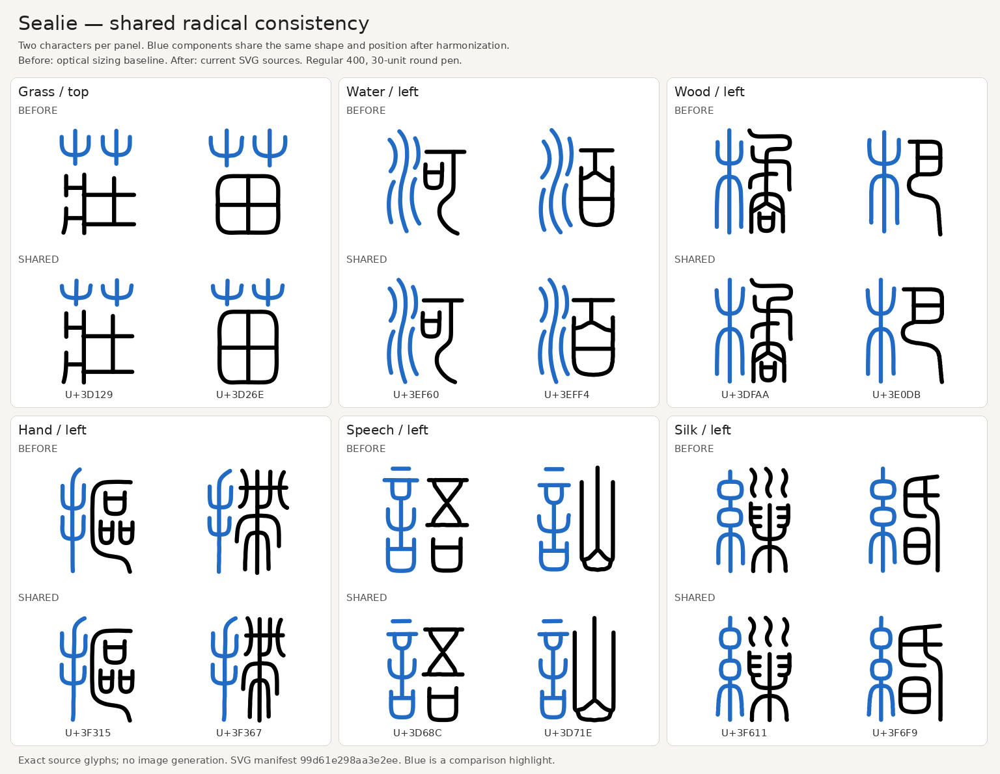
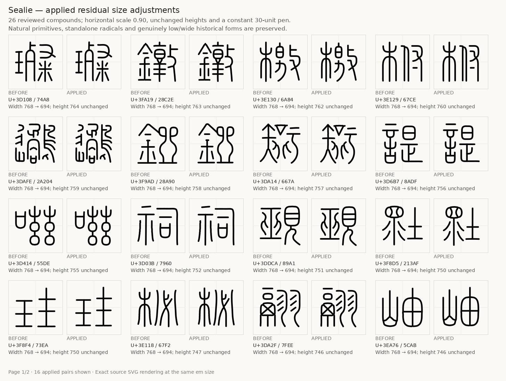

# Size and radical normalization

The first normalization covers the complete 11,328-codepoint Small Seal repertoire. It changed 10,511 SVGs and preserved 817 exactly. The previous source is available at [commit 770c0d5](https://github.com/iebb/sealie/tree/770c0d56e570000f1231c2fe9b4d275fbb426fc6). The later cap revision added bounded size and endpoint corrections. The current [radical and join revision](https://github.com/iebb/sealie/releases/tag/radical-joins-011328) adds 627 registered shared-radical glyphs and refines local parent curves at stroke joins. It changes 762 SVGs relative to the previous normalized-cap revision.

## What changed

All previous glyphs already shared a 738-unit maximum centerline extent and geometric centering. Their apparent sizes still differed because widths, component proportions and ink centroids varied. Applying another uniform bounding-box fit would not solve that problem.

For full-height compounds with at least five paths and an ink width of at least 360 units, the optical pass moves the ink width toward a common target:

```text
target_width = 560 + 0.35 × (original_ink_width − 560)
x_scale = clamp((target_width − 30) / (original_ink_width − 30), 0.90, 1.12)
```

It applies a quarter of the measured ink-centroid correction, capped at 12 horizontal and 16 vertical units. The pen remains 30 units. Simple strokes, narrow forms, short forms and standalone dictionary radicals retain their existing geometry. The reusable calculation is in [optical_fit.py](../tools/optical_fit.py).

## Shared components

The official `kSEAL_Rad` classification in [SealSources.txt](https://www.unicode.org/Public/18.0.0/ucd/SealSources.txt) identifies semantic radical families. Classification alone does not identify a component's strokes or placement. Candidates were isolated as whole path groups and compared within the same family and position, using normalized shape distance, contact topology and clearance.

The first component review covered all 202 candidate cluster medoids and their least similar examples, with radical-root comparisons. Fifteen clusters containing partial radicals or an extra body stroke were excluded. Ordinary water, wood, hand, speech and selected grass/silk forms were consolidated where differences were drawing noise. Distinct allographs remain separate.

The current **173 SVG templates serve 3,473 glyphs**. This pass adds 309 occurrences of existing templates and 318 occurrences using 11 new templates. New shared forms include left 人 and 石, right 刀, connected and detached 虫 forms, and 日 and 口 in reviewed positions and layout bands. Whole-radical source review precedes reflow; distinct contact forms and positions stay separate.

Every registered occurrence has exactly the same component geometry, size and position. Remaining strokes are reflowed into the shared layout. The total composed remainder scale stays within 0.80–1.25 relative to the input baseline, and component-to-remainder centerline clearance is at least 35 units. Actual whole-path checks hold proposals that introduce Regular-weight contacts or lose the existing half-unit safety margin. The [radical expansion report](../reports/radical-expansion.json) records the current accepted set. The first pass's rejection of 113 excessive reflows remains recorded in its original review.

The templates and assignments are maintained in [components/](../components/). To propagate a template edit:

```sh
python tools/sync_components.py --apply
python tools/sync_components.py --check
```

The check verifies numerical equality, closures, assignments and current SVG hashes. A radical's different position or structural allograph gets its own template. Ambiguous and excessively distorted matches retain their earlier geometry. Overlapping component bounding boxes require actual path-clearance and contact checks. Exact sharing applies to the registered occurrences, not every possible radical in every character.




## First normalization measurements

The first normalization's full original and final sets were measured with the same 256-pixel antialiased round-stroke method. The original audit was reused; one new full-set pass measured the final revision. Values below are in the 1024-unit font frame.

| Measurement | Before | After |
| --- | ---: | ---: |
| Ink width, 5th percentile | 419.9 | 460.4 |
| Ink width, median | 535.3 | 552.1 |
| Ink width, 95th percentile | 665.6 | 598.7 |
| Central 90% width span | 245.7 | 138.2 |
| Median ink-centroid offset | 24.0 | 19.4 |
| 95th-percentile ink-centroid offset | 63.7 | 52.4 |

The central width spread fell **43.75%**. Maximum ink width and height remain 768 units. Natural primitives remain intentionally sparse. See the [machine-readable metrics](../reports/normalization.json) and [width/centroid comparison](../previews/normalization-metrics.png).

## Earlier size and endpoint cleanup

The earlier cap revision fitted 26 previously untouched broad compounds whose near-full heights fell just below the original exact-height guard. Each receives a single horizontal scale of 0.90, with no vertical stretch or pen scaling. Registered shared components and genuinely low, wide forms are excluded. An executed minimum-distance check over 2,567 source path pairs rejected two proposals that would create new Regular-weight contacts; both glyphs retain their prior size. See the [size-fit report](../reports/supplementary-size-fit.json) and [contact distances](../reports/size-fit-contact-check.json).



Every source already has a 30-unit Regular pen with round caps and joins. A full serialized Regular audit found degenerate contours only in U+3D4D9: tiny terminal loops triggered the legacy fallback. Removing eight endpoint vertices restores compatible analytic strokes at all five weights, reducing that glyph from 1,706 contours to 22. The backend remains unchanged.

The reusable cleanup removes consecutive terminal vertices only within 0.25 units of a fixed endpoint. It preserves all stroke endpoints, stroke count, closure flags and meaningful hooks; interior short segments remain unchanged. Larger visible cap defects received codepoint-specific reviewed repairs. Shared paths were updated through their templates. The [cap cleanup report](../reports/cap-cleanup.json) remains the historical source record for that pass.

The full before/after measurements above describe the first normalized source manifest recorded in `normalization.json`. Later cleanup and radical expansion have their own source identities and reports; the measurements above retain their original baseline.

## Current join refinement

The remaining bumps at U+3D7B7's bowl-to-leg joins came from waves in the parent curves. Focused smoothing now corrects those curves while preserving the leg endpoints and surrounding outline. The source and compiled-font comparison shows the result:


Three canonical templates also receive bounded, tangent-matched parent-curve repairs at ordinary stem joins. They remove local notches in two bottom bars and one roof apex; the largest centerline movement is under 4.06 units. Caps, endpoints, other template paths and geometry outside the reviewed windows stay fixed. Each change is synchronized to every registered copy: 68 gold, 37 soil and 33 roof instances, totaling 138. Four copies also belong to this pass's 627 new assignments, so the radical and join changes affect 762 distinct glyph SVGs.


Independent review compared whole shapes and source/compiled join crops at all five weights. The [join refinement report](../reports/join-refinement.json) records the exact repair scope and source identities. The earlier endpoint-cleanup images and report remain historical evidence.

## Builds and review scope

The normalized builder creates five static weights, a 300–700 variable font and webfont subsets from these SVGs. Its compact round stroker preserves source polylines; it falls back to the original stroker for all masters of a glyph if compact master topology changes. Chunk merging checks serialized glyph and variation preservation. See the [build guide](BUILD-FROM-SVG.md).

The original reference reviews remain historical evidence. This revision has full geometric/source checks, independently reviewed component groups and representative final visual comparisons. It does not claim exhaustive optical approval at every weight. The [previous prerelease](https://github.com/iebb/sealie/releases/tag/checkpoint-011328) and its reports describe the earlier outlines; the current radical and join release has its own [font hashes and build report](../reports/normalized-font-build.json) and [validation report](../reports/normalized-font-validation.json).
