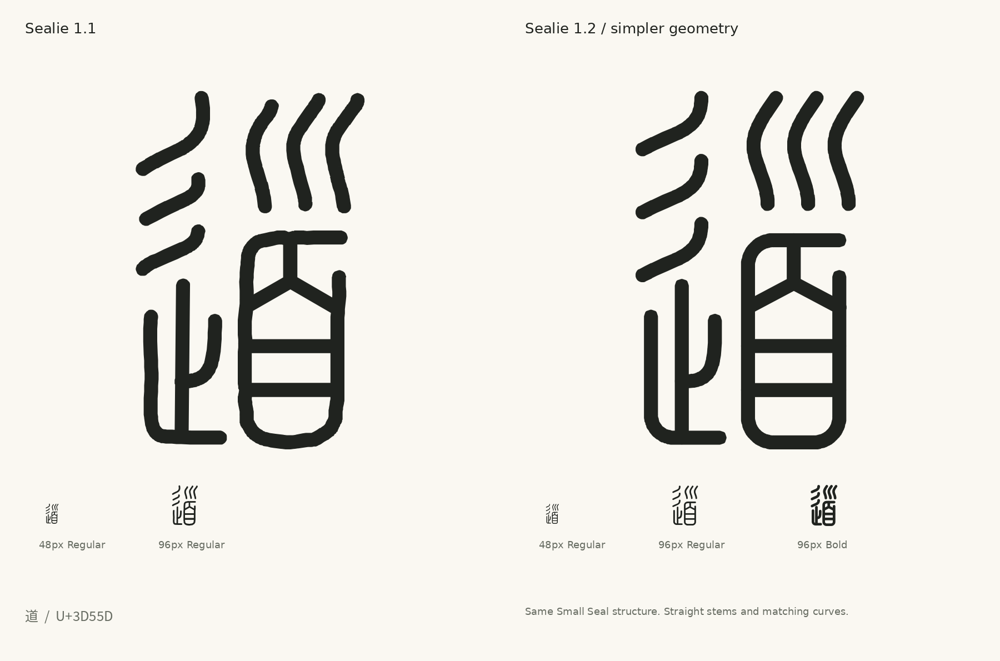

# Geometry, optical sizing and shared radicals

Sealie uses simple curves, straight stems and round turns within a consistent optical frame. The **v1.2.0** sources cover all 11,328 Small Seal codepoints in a 1024-unit em, with a fixed 1024-unit advance. Regular uses a 30-unit round pen; all five weights follow the same centerlines.

## Simpler geometry

The general editing pass removes tracing wobble and unnecessary centerline detail without changing the Small Seal stroke structures. Nearly horizontal and vertical runs are aligned, smooth curves use fewer fitted segments, and coincident junctions move together. Source path counts, path order and closure flags are retained. The maintained SVGs continue to use absolute `M`, `L` and terminal `Z` commands.

| Operation | Source-editing limit | Treatment |
| --- | --- | --- |
| General curve cleanup | 2.55 font units | Corner-aware fitting with endpoints, intersections and frame extrema constrained |
| Long near-axis traces | 6 font units | Straighten eligible stems and bars, coordinating connected junctions |
| Curve flattening | 0.4 font units | Store fitted curves as editable polylines |

The displacement check uses GEOS discrete Hausdorff distance with quarter-segment densification. It is a sampled geometric comparison, not an analytic continuous-distance proof. The [geometric source report](../reports/geometric-simplification.json) records accepted edits, retained paths and their exact source identities.

A separate, deliberate redraw gives **道 (U+3D55D)** straight sides, a regular rounded eye, a symmetric internal Y, and matching repeated curves. It retains 15 open source paths and its **490×768-unit Regular ink frame**. The general displacement budgets do not describe that redesign.



The simpler drawing retains the encoded Small Seal structures and their historical variants.

## Joins, gaps and counters

Source comparisons check complete distinct-path contact relationships at all five pen widths: **23.5, 30, 36.5, 43 and 49.5 units**. They compare both added and lost contacts, and protect the half-unit gap threshold where it existed before editing. Sensitive paths retain their earlier geometry when a proposal cannot satisfy those constraints. A shared-template path is retained consistently across its registered copies.

Valid explicitly closed source rings are also compared at each named weight to check that previously open counters survive. These source checks have a defined scope: they do not establish safety for every self-overlap in an open path or every loop assembled from several paths. Compiled-font validation and the selected visual review are recorded separately in [normalized-font-validation.json](../reports/normalized-font-validation.json) and [geometry-review.json](../reports/geometry-review.json).

## Optical frames

The geometric design retains the optical frames established in v1.1. Ordinary upright forms use a **768-unit ink height** and common vertical center, with naturally different widths. A simple character such as 可 or 名 belongs to the same height group as a complex character such as 道 or 常. Deliberately shorter forms use individual heights rather than one reduction based on path count.

| Form | Optical target established in v1.1 |
| --- | --- |
| Ordinary upright characters | 768 units high; preferred maximum width 520 units |
| Shorter forms | Examples: 王 620, 工 580, 土 680, 士 640, 日 640 and 田 640 units high |
| Single horizontal bar | 470×30 units |
| Two, three or four horizontal bars | 430 units wide; 440, 540 or 640 units high |

These targets are not unconditional bounds. Dense forms and shared-template families can retain extra width to keep gaps open. The [v1.1 sizing report](../reports/optical-sizing.json) records that size-fitting stage; its glyph hashes and measurements precede the geometric cleanup. The current source report records the edited outlines. Earlier [alignment](../previews/optical-alignment.png) and [primitive](../previews/optical-primitives.png) comparisons retain their v1.1 scope.

### Proportion reference

**方正小篆体 (FZXiaoZhuanTi-S13T)** provides the optical proportion reference. See the [official description](https://www.foundertype.com/index.php/FontInfo/ductdetail/id/165.html) and [distributor listing](https://lets.fontworks.co.jp/fonts/492).

The v1.1 comparison measured **257 ink-bearing characters out of 292 requested** from a [public raster preview](https://www.fonts.net.cn/font-31681245180.html); 35 blank previews were excluded. The 32-point previews use 56-pixel canvases, with approximately ±1 pixel of bounding-box uncertainty. The [reference report](../reports/reference-dimensions.json) contains numeric measurements and source URLs. It is not a survey of the complete reference font, and reference fonts, raster images and outlines are not redistributed.

The sizing mapped a 39-pixel ordinary body to 768 units. Short forms with reference heights of 29–36 pixels used `768 × reference height ÷ 39`, rounded to 20 units. Preferred widths used `768 × reference width ÷ 39 × 1.08`, rounded to 10 units and capped at 520. Horizontal bars had separate profiles. These are the origin of Sealie's optical frames, not current per-glyph outline measurements.

## Exact shared radicals

The official `kSEAL_Rad` classification in [SealSources.txt](https://www.unicode.org/Public/18.0.0/ucd/SealSources.txt) identifies semantic families. Shared geometry is assigned after reviewing a whole component in the same position and structural allograph. Partial radicals, different joins and ambiguous matches remain separate.

The atlas contains **180 templates registered to 3,763 glyphs**. Every registered copy uses **the same component geometry, dimensions and placement**. A template is simplified once and propagated to its instances; copies are not independently smoothed or squeezed. Other forms retain individual drawings.

To propagate an intentional template edit:

```sh
python tools/sync_components.py --apply
python tools/sync_components.py --check
```

The check verifies exact registered copies, closures, assignment integrity and current hashes. See the [component guide](../components/README.md).

## Builds and evidence

The [build guide](BUILD-FROM-SVG.md) explains static and 300–700 variable builds from the maintained SVGs. Building does not repeat the design simplification: it expands the stored centerlines with the same round pen model. Current source, compiled-font and selected visual evidence have separate reports and hashes.

The v1.0 [radical expansion](../reports/radical-expansion-v4.json) and [cap refinement](../reports/cap-refinement.json), the v1.1 [optical review](../reports/optical-review.json), and the earlier normalization and join reports retain their original source identities. Changed outlines do not inherit exact-byte validation from an older drawing. Earlier sources remain in Git history: [initial complete checkpoint](https://github.com/iebb/sealie/tree/checkpoint-011328), [v1.0.0](https://github.com/iebb/sealie/tree/v1.0.0) and [v1.1.0](https://github.com/iebb/sealie/tree/v1.1.0).

[Live variable specimen](https://iebb.github.io/sealie/) · [Character library and coverage](https://iebb.github.io/sealie/characters.html) · [Latest font assets](https://github.com/iebb/sealie/releases/latest)

## 中文

当前 **v1.2.0** 以简练的曲线、平直的字干和圆润的转折整理小篆字形，沿用 v1.1 建立的视觉尺寸。一般曲线清理采用 **2.55 单位**的位移范围；长而接近水平或垂直的笔画另有 **6 单位**的规整范围。连接点协同移动，路径数量、次序和闭合标记保留。拟合曲线以 **0.4 单位**容差转换为可编辑的 `M`/`L` 折线。位移检查采用加密采样的离散 Hausdorff 距离，并不是连续曲线距离的解析证明。

**道（U+3D55D）**另作明确的几何重绘：平直两侧、规整圆角字腔、对称的内部 Y 形，以及一致的重复曲线；保留 **15 条开放路径**及 **490×768 单位**的 Regular 墨迹框。这项重绘与一般受限清理分开记录；简练的造型保留小篆结构、编码及历史异体。

笔画间的接触关系按五个笔宽 **23.5、30、36.5、43、49.5 单位**比较，检查新增和丢失的接触，并保护原有半单位留白阈值；敏感路径在必要时保留原形。有效闭合中心线路径中原先存在的字腔，按各字重分别比较。源路径检查、编译后验证及样本视觉审查各有明确范围，记录于[几何报告](../reports/geometric-simplification.json)、[字体验证](../reports/normalized-font-validation.json)及[视觉审查](../reports/geometry-review.json)。

**180 个共享模板用于 3,763 个字形**；每个模板只处理一次，所有登记副本保持相同的形状、尺寸和位置。一般字身沿用 768 单位高度，较矮的基本形式使用各自视觉高度，密集结构可保留较宽尺寸。旧[尺寸报告](../reports/optical-sizing.json)、[视觉审查](../reports/optical-review.json)及[参考尺寸](../reports/reference-dimensions.json)保留 v1.1 的源文件身份，不代表当前轮廓的重新测量。
